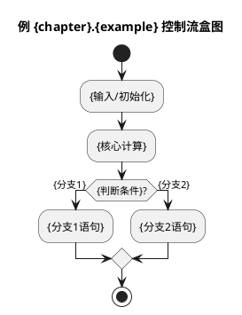

## Overview
This skill automates the process of converting textbook example screenshots into well-structured C source files. It reads programming example images (typically from 谭浩强《C程序设计》教材), extracts the code, adds comprehensive Chinese annotations including problem-solving approaches, key concepts, and difficulties, then saves the file to the appropriate chapter directory with standardized naming.

## Target Textbook
- 谭浩强《C 程序设计》——🔴**版次口径（与常驻规则 `core-role.md` 的版次口径红线一致）：学生纸质书为第 6 版（无电子版），一切提取/核对以本地第 5 版扫描件与 `0_textbook_code/教材目录映射.md` 为准**（定位课本原文先查映射表，不凭记忆猜章号页码）。
- Compilation standard: `-std=gnu17` (teaching uses C99, which is fully compatible)
- Target audience: First-year university students with zero programming background

## File Naming Convention
- Chapter directory: `01`, `02`, `03`, etc. (two digits)
- Example naming: `li{chapter}.{example}.c`
  - Example: 例 1.1 → `li1.1.c`
  - Example: 例 3.5 → `li3.5.c`
- Exercise naming: `ex{chapter}.{exercise}.c`

## Directory Structure
```
c99_env/
└── 0_textbook_code/
    ├── 01/          # Chapter 1 examples
    ├── 02/          # Chapter 2 examples
    └── ...
```

## Source File Template
Every extracted source file must follow this structure:

```c
/*
 * 例 {chapter}.{example}：{title}
 * 
 * 解题思路：
 * --------
 * {problem description and approach}
 * 
 * 关键知识点：
 * ----------
 * - {key concept 1}
 * - {key concept 2}
 * 
 * 难点：
 * ----
 * - {difficulty 1}
 * - {difficulty 2}
 * 
 * 易错易混点：
 * ----------
 * - {common mistake 1}
 * - {common mistake 2}
 * - {common mistake 3}
 * - {common mistake 4}
 * 
 * 内存与编译器原理：
 * ----------------
 * - {memory/compiler principle 1}
 * - {memory/compiler principle 2}
 * - {memory/compiler principle 3}
 * - {memory/compiler principle 4}
 */

#include <stdio.h>    /* header comments */

int main()            /* function comments */
{
    // detailed line-by-line comments
    return 0;
}

/*
 * 【讲解过程稿】（第一人称口播稿，师生共读，放在源码最末尾；不写“老师照着讲”等教师腔 meta；开门见山、不装腔不报幕、不卖关子，中途设真实互动（提问后等学生答、或临时出题小测），别自问自答一路独白；全文必须有一句“学生自己搜不到”的点破话，详见 `lecture-script.md`）
 * 🔴**骨架优先照搬课本该例题实际出现的小标题顺序**（老师、学生、课本三方同一副骨架，最省事最有条理）；**绝不给课本没有的步骤硬造标题**（课本从不单列“设计算法”，算法/N-S 图都归在“解题思路”里）。按题型二选一：
 *
 * 【题型 A·求解型】（课本有“解题思路”，如例3.1/3.2/3.3/3.8）
 * 开场：{一句话点破本题要害，直接讲；不装腔不报幕、**不设悬问、不卖关子**}【若有可验证的提问：等学生答约 2~3 秒，接住再往下】
 * 解题思路：{对应课本“解题思路”——一句话说清题意 + 整体大思路（先讲结构/算法骨架，**不逐行念代码**）；复杂题的算法/N-S 图也讲在这一块里}
 * 编写程序：{对应课本“编写程序”——按逻辑块逐块走，每块说清“这里在干嘛、为什么这么写”}
 *   - {逻辑块1：这里在干嘛、为什么这么写}
 *   - {逻辑块2：...}
 * 运行结果：{对应课本“运行结果”——当堂对答案/验证一下}
 * 程序分析：{对应课本“程序分析”——本例最该强调的一处/易错点，就写那句“学生自己搜不到”的话：为什么这么写、不这样会出什么事、坑精确在哪一步}
 * 收尾：{一句话总结 + 抛一个提问给学生}【互动停顿：该提问必须是学生此刻答得出的，并当堂揭晓答案；不得只抛不接当下节课钩子】
 *
 * 【题型 B·验证型】（课本无“解题思路”、一句题干直接上代码，如例3.6/3.7）——**跳过“解题思路”，不硬造**：
 * 开场：{一句话点破本题要验证什么现象}
 * 编写程序：{直接按逻辑块读代码，说清每块在干嘛、为什么}
 * 运行结果：{观察现象是本页核心——屏幕上到底出了什么}
 * 说明：{点破为什么出这个结果——就写那句“学生搜不到”的话}
 * 收尾：{一句话总结 + 抛一个学生此刻答得出的提问}【互动停顿：当堂揭晓】
 */

/*
 * 【配图】见同目录 li{chapter}.{example}.puml（PlantUML 活动图/盒图，打开即渲染，讲分支/循环时投屏）。
 * 图只在 .puml 存一份，本 .c 文件不内嵌图。
 */
```

## Diagram Sidecar File (.puml)

> 🔴**口径澄清（防混淆，与规则 `textbook-c-code.md` 一致）**：本节的 `.puml` 是**例题控制流图**（`textbook-c-code.md`「配图旁挂」条，由 CLion 的 plantuml4idea 插件本地渲染），**每个例题照旧要产**；它与 `ppt-diagram-maker` / 规则 `ppt-diagram.md` 里**已弃用的“课件图 `.puml`→豆包”**是两类东西——课件图 / 节首划概念页一律走“手写 SVG→sharp 转 PNG→python-pptx 直插 PPT、不再产 `.puml`、不走豆包”。一句话：**例题图用 `.puml`，课件图用 SVG。**
Each example also ships a same-directory `li{chapter}.{example}.puml` holding the control-flow diagram (activity / box-diagram 盒图 style). CLion's **plantuml4idea** plugin renders it live (open the file → preview pane); the `.c` file only carries a one-line pointer to it. CMake globs only `*.c`, so `.puml` never affects the build.



## Execution Steps

1. **Read Image**: Use MCP tool to read the screenshot image
2. **Extract Information**:
   - Chapter number (from section like "1.4.1")
   - Example number (from "例 1.1")
   - Title/description
   - Problem requirements
   - Source code
   - Existing comments
3. **Add Annotations**:
   - **解题思路** (Problem-solving approach): Explain the logic and strategy
   - **关键知识点** (Key concepts): List important C concepts used
   - **难点** (Difficulties): Highlight tricky parts for beginners
   - 易错易混点：
   - 内存与编译器原理：
   - **讲解过程稿** (Teaching walkthrough script): A ready-to-speak, first-person script appended at the END of the file, readable by BOTH teacher and students (no teacher-only meta like "老师照着讲"). 🔴**The SKELETON must mirror the textbook's OWN section labels for that example** (teacher, student, and book share one outline — the least effort and the clearest): 求解型 = 解题思路 → 编写程序 → 运行结果 → 程序分析; 验证型 (book has NO 解题思路, e.g. 例3.6/3.7) = 编写程序 → 运行结果 → 说明, **skip 解题思路, never invent a heading the book doesn't have** (the book never lists "设计算法" separately — the algorithm/N-S chart lives INSIDE 解题思路). **Open by stating the point outright — no hook, no suspense, no riddle.** State the problem in one line, give the overall structure FIRST (never read line-by-line), walk logical chunks, flag the key turning point, close with a summary + a question. Add 【互动停顿】markers only at questions students can answer **right now** (predict this program's output, true/false, choral answer) and **reveal the answer in the same class period**. Speak plainly: no posturing ("别被这个词唬住""就这么朴素""先给个公式镇场子"), no announcing your own move ("我给你举个例子""我考两个问题") — just give the example or ask the question. 🔴**Never sell suspense**: forbidden are "咱们下课再回头看这个问题""看谁说得准""先记住这个问号""这个名字先存着" — anything already explainable must be explained on the spot. These students are zero-background freshmen, and definitions/grammar/step-by-step solutions are one search away on Bilibili or any AI; **a script that re-reads the textbook gives them no reason to attend class**. Every script must therefore contain at least one line they **cannot google** — why it is designed this way, what breaks if it weren't, exactly which step the trap sits in, how a practicing engineer handles it. Order: **point it out first, then let students verify** — not ask first and explain two pages later. See `lecture-script.md` (三不一破).
4. **Format Code**:
   - Use C99/gnu17 compatible syntax only
   - Add detailed Chinese comments for every line/block
   - Ensure proper indentation and style
5. **Save File**:
   - Target directory: `c99_env/0_textbook_code/{chapter}/`
   - Filename: `li{chapter}.{example}.c`
   - Create directory if it doesn't exist
6. **Create Diagram Sidecar**: Write a same-directory `li{chapter}.{example}.puml` with the control-flow (activity/盒图) diagram; the `.c` keeps only a one-line pointer to it (no embedded diagram).

## Comment Guidelines

- **Header comment**: Multi-line `/* */` block with problem info
- **Include statements**: Inline `/* */` explaining purpose
- **Function definitions**: Inline `/* */` for function role
- **Code blocks**: Mix of `/* */` and `//` for clarity
- **Language**: Always use Chinese for comments
- **Beginner-friendly**: Use analogies and avoid jargon
- **Student-neutral labels**: Section titles are read by teacher AND students; never write teacher-only meta such as "（老师上课可直接照着讲的口播稿）" or "讲课时可逐条说". Use neutral phrasing, e.g. 关键知识点（对应课本"程序分析"）.
- **Plain spoken voice, real interaction, no suspense, one sharp insight (`lecture-script.md` “三不一破”)**: the 讲解过程稿 must not posture ("别被这个词唬住""就这么朴素""这是全章的高潮""镇场子") or announce its own moves ("我给你举个例子""我考两个问题""接下来看") — just state, exemplify, or ask directly. Avoid self-question-self-answer monologue: pose a real question **students can answer at this moment** and pause for them, or drop a quick in-class check. **Never hold an answer back as a hook** (no "下课再回头看""先记住这个问号""名字先存着") — break the point on the spot. And every script must carry at least one line the student cannot get from a web search or an AI answer (why / what breaks / where the trap is / how pros handle it); the textbook re-read alone is not a lesson.
- **No suspense anywhere**: the section title's big words and the lesson's intent are cleared up in the opening lines, not deferred to the end of class.
- **Operator integrity**: When transcribing code, double-check `*`, `+`, `-`, `/`, parentheses are intact (OCR/copy often drops them); final check = compiles with `gcc -std=gnu17`.

## Quality Standards

1. **Compilable**: Code must compile with `gcc -std=gnu17` without errors
2. **No legacy functions**: Avoid `conio.h`, `getch()`, `system("pause")`
3. **UTF-8 encoding**: Ensure Chinese comments display correctly
4. **Educational value**: Comments should teach, not just describe
5. **Consistent style**: Match existing project code style
6. **Diagram sidecar**: Each example ships a `li{chapter}.{example}.puml` (rendered by plantuml4idea); the `.c` carries only a pointer, no embedded diagram.

## When to Apply

Trigger this skill when the user:
- Provides a textbook screenshot image path
- Explicitly mentions extracting code from textbook
- Uses keywords: "教材例题", "提取代码", "谭浩强", "C程序设计"
- Provides chapter/example numbers with an image

## Example Usage

**User input:**
```
D:\PIXPIN_PICS\example.png，提取源码，放在 @01，命名 li1.1.c
```

**Skill actions:**
1. Read image from `D:\PIXPIN_PICS\example.png`
2. Extract code and problem description
3. Add 解题思路、关键知识点、难点、 易错易混点、内存与编译器原理 sections
4. Append 讲解过程稿 (teaching walkthrough script) with 【互动停顿】markers at the end of the file
5. Format with detailed comments
6. Save to `c99_env/0_textbook_code/01/li1.1.c`
7. Create sidecar `c99_env/0_textbook_code/01/li1.1.puml` with the control-flow diagram; `.c` keeps only a pointer

## Error Handling

- If image path is restricted (C:\Users\AppData\...): Use `read-external-image` skill first
- If chapter directory doesn't exist: Create it automatically
- If code uses non-standard headers: Replace with standard alternatives and add explanation comment
- If encoding issues: Ensure file is saved as UTF-8
